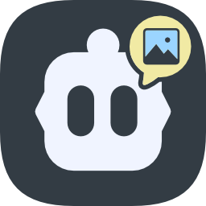

# Cline Cubed

  

Want several Cline chats running at the same time, side by side? **Get Cline Cubed!**

Want them all still there after you reload the window — or reinstall? **Get Cline Cubed!**

Want a longer chat context that remembers more, and never forgets the key context files you say
matter most? **Get Cline Cubed!**

Want your chats and your files to stop fighting over the same editor space?
**Get Cline Cubed!**

Want to use affordable text-only models for Plan and Act, yet still paste an image
and have your chat understand it? **Get Cline Cubed!**

If you love Cline but want more of it, get Cline Cubed.

---

A fork of [Cline](https://github.com/cline/cline) that grows it in several directions
at once.

**Run several chats side by side** — each its own conversation, with its own work, its
own thinking indicator and its own Cancel, so a long refactor keeps running in one while
you ask something else in another. **Keep the workspace tidy** — chats gather as tabs in
a single locked editor group, files open in a group of their own, and edited files leave
one preview tab instead of a pile. **Come back to it** — after a window reload, or a full
reinstall, every chat returns with its conversation. **Know when everything happened** —
every message carries its own timestamp. **Keep its context** — compaction goes by your model's
real token count, so a long chat holds on to far more, and the files you name are never
forgotten. And a third model channel, **Image Mode**, lets
a text-only Plan/Act model understand a pasted image: your vision model describes it, the
description is bridged in as a collapsible, copyable block, and the reasoning model never
receives raw image bytes.

- **Multiple chats at once** — each keyed to its own conversation, running side by side,
  cancelling independently.
- **Chats that name themselves** — on your first message the chat takes a short name from what
  you asked for, using the provider and model you already use. A name you type always wins.
- **A workspace that stays tidy** — chats gather as tabs in one locked group; files open
  in a group of their own and leave one preview tab, not a pile.
- **Chats that come back** — after a window reload, and after a reinstall, each with its
  own conversation.
- **Every message stamped with its time** — quiet in the chat, full precision on hover
  and in every copy-and-paste.
- **Prompt history in the chat box** — `↑` and `↓` walk back through what you typed,
  per chat.
- **A suggested reply when the agent asks for your go** — the empty box offers a one-line "yes, …"
  reply; Tab puts it in the box, and nothing is sent on its own.
- **Chats that keep their context** — compaction goes by the token count your model's server
  really reports, so it happens far less often and keeps far more; and with **Always Remembered
  Files**, the files your agent must never forget go with every request, where no compaction can
  remove them.
- **Settings that show what is sent** — stock Cline's Settings could show a model you never chose
  and a Temperature that was never sent. Here, a mode with no model says "No model selected" so
  you can fix it; reasoning effort, Temperature, and output limits are sent exactly as their tabs
  show them.
- **Three model channels — Plan, Act, and Image Mode.** Each tab in API Configuration
  keeps its own provider, model, API key, and reasoning effort.
- **Capability-aware image bridge** — it runs only when the active Plan/Act model is
  non-vision (or unknown); vision-capable models receive the raw image as usual.
- **One master debug-logging switch** — Settings → General → **Debug logging**, off by
  default, turns on diagnostic output for the whole extension (the image bridge's per-call
  records among them: provider, model, URL, image type and size, auth, and status) in the output
  channel. Errors and warnings are never gated by it, and a
  failed bridge call still shows its recent calls inline in the chat.
- **Update notices** — after an update, a notice names the new version and **What's New** opens
  in the chat view with this fork's own notes for that version, shipped inside the extension
  (**Cline Cubed: What's New** in the Command Palette brings them back any time); with VS Code's
  automatic extension updates off, Cline Cubed checks the Marketplace at start and asks whether
  to update — Yes installs in place, Not now waits.
- **Commands land in the chat you are working in** — click into a chat's prompt box and it
  becomes the one your commands reach: Jump to Chat Input, Settings, History, MCP Servers,
  Marketplace, Account and New Chat all arrive there, or, with no chat tapped, in the location
  chosen in Settings. In the Command Palette the toolbar commands carry the "Cline Cubed" prefix,
  and the names say what they do — New Chat, Marketplace, and Close Chat on the X that closes a
  chat.

## Chat layout (mirrors Claude Code)

Three New Chat buttons are always within reach — in the chats list's toolbar, at the top of
the editor, and at the top of the secondary sidebar chat. Every one opens or creates a chat
**in the location chosen in Settings**. (The Cline Cubed icon in the primary sidebar opens
your chats list rather than a chat — see "Your chats, listed" below.)

Every button behaves the same way. When the target area has **no chat**, you get the
**"What can I do for you?"** home — a chat whose default is also the history chooser
(recent chats, plus the prompt input at the bottom to start a new task). When a chat is
**already there**, a **new, independent chat** opens beside it and the existing one keeps
running, untouched.

That gives you **multiple chat sessions side by side** — each keyed to its own
conversation, each showing its own work. The secondary sidebar hosts one chat at full
height; further chats gather as tabs in a single editor group, so you slide the tab strip
between them.

A chat lives in one place and stays there: try to open one that is already open and the
panel running it comes forward with a brief notice, while the panel you clicked in is left
exactly as it was — nothing moves. Close a chat's tab, or the sidebar holding a chat, and that
chat ends; drag the docked chat to the other sidebar and it comes with you.

**Every chat owns its own busy state.** Each shows its own thinking indicator while it
works, and its own Cancel button, from its very first response onward — and cancelling
one chat stops that chat while every other chat keeps running.

New chat sessions open in the location picked by the **"Where new chat sessions open"**
setting (Settings → General, and offered on Get Started):

- **Editor area** (new tab) — the default
- **Secondary sidebar** (typically right)

The secondary sidebar can house only one chat, at full height, so the two choices come out like this: pick
**Secondary sidebar** and your first chat docks there while every later one opens as an editor
tab; pick **Editor area** and nothing docks at all — every chat is an editor tab. The setting
governs where new chats open; chats you already have open stay where they are. A gear button in the chat input row opens Settings quickly,
restoring the settings affordance stock Cline removed from the VS Code panel.

## Chats in one group, files in another

Cline Cubed gives chats and files their own homes, so neither ends up buried in the other.

**Every chat you open in the editor area gathers as a tab in ONE group.** Slide along the tab
strip to move between them exactly as you would between files, each tab carrying its chat's own
name. That group is locked, so nothing can drop a file on top of a conversation you are reading.

**Files go somewhere else, chosen with care.** A file Cline Cubed opens never lands in your chats
group — and never in a group holding another extension's chat panel either. If the only things
open are chat panels, it opens a fresh group for your files rather than intruding on anybody's
conversation.

**And files do not pile up.** An edited file appears in a preview tab — the italic one VS Code
replaces in place — so a session that edits ten files leaves one tab, not ten. A tab you opened
yourself is never closed and never quietly converted into a preview.

## Your chats come back

Reload the window and your chats are still there: every editor tab with its own conversation, and
the docked secondary-sidebar chat with its own. Uninstall, reinstall, reload — still there. The
record rides in VS Code's own workspace storage, so it outlasts far more than a restart, and a chat
you opened from your history is restored exactly like one you started by typing.

## Your chats, listed

The Cline Cubed icon in the **primary sidebar** opens a **chats list** rather than a chat: the chats open right now
sit at the top, each labelled with where it is, and your full history follows underneath. A New
Chat button sits above them, and the Settings, Account, and Marketplace buttons open right there
in the panel instead of commandeering one of your running chats.

Clicking a row opens that chat — one target, one outcome. If that chat is already open somewhere,
it is brought into view where it already lives: the panel running it comes forward, a brief notice
tells you it was already open, and the panel you clicked in stays exactly as it was — so a chat can
never be pulled out from under a half-typed message. A chat open nowhere opens in the surface you
clicked from when that surface is an empty home, and in a new editor tab when it is already showing
a chat: clicking three chats gives three windows, and the chat you are working in is never taken
from you. The per-row controls appear on hover at the right: details, favorite, and delete; clearing
the whole history is a single quiet control under the list. The chats list and the history panel inside a chat are the same component,
so both behave identically.

When a chat does open a brand-new editor column, the column widths are evened, so it never arrives
as a sliver beside a wide one.

## Name your chats

**On its first message, a new chat names itself.** It asks your own provider — the model you
already use, in whichever channel the chat is in — for a short name taken from what you asked
for, and that name appears in the editor tab, the chats list and the header at the top of the
chat. The request goes out alongside your first message and is never waited on, so your reply
starts exactly as fast as before and the name arrives a moment later. Nothing new to set up and
no second account. If no name comes back, nothing is reported and the chat keeps showing your
first message. It is on to begin with, and Settings → General → **Name new chats automatically**
turns it off for anyone who would rather not spend the one small request per chat.

A name you type always wins. Every chat is displayed by its first prompt until it has a name of
its own, and a chat you have named yourself is never renamed for you. At the top of a
chat, hover the name and click it, or the pencil beside it, to edit in place; on a row in the chats
list or history, the name opens the chat and the pencil beside it renames. Renaming a chat, or
marking it a favorite, never moves it in the list. Enter or clicking away commits, Escape cancels,
and clearing the box restores the first prompt, so a rename is always undoable.

Renaming never rewrites what you actually typed: the name is stored in a field of its own, and your
first prompt stays intact in the chat's expanded details. The name shows everywhere the chat is
listed — the header at the top of the chat, history rows, the home screen's recent list, the chats
list, and its **editor tab** — and fuzzy search matches it as well as the prompt, so a renamed chat
is findable by its new name.

**Editor tabs are named too**, which is what makes several open chats worth having: a tab carries
its chat's name, or its first prompt if you have not renamed it, so every tab is distinguishable
rather than a row of identical ones. A long prompt is shortened to fit the tab strip, and a tab
with no chat in it yet reads "Cline Cubed". Tabs keep up on their own — a new chat's tab takes its
name as soon as the first prompt lands, a rename relabels the tab at once, and closing the chat
inside a tab returns it to "Cline Cubed".

## Every message stamped with its time

Every message carries the moment it happened, in your own timezone, rendered right in the chat —
no tokens spent and nothing sent anywhere to produce it.

The label stays quiet: **5:23 PM**, floated to the right of the message's first line so your text
wraps around it. Hover it and it expands, after a short pause and with a soft animation, into the
full stamp — **Aug 30, 2026, 5:23:12.179 PM**. Copy a message and that full stamp comes with it,
along with an invisible `User:` / `AI:` marker, so a conversation pasted anywhere reads correctly
without you labelling it by hand. Reopen an old chat and its messages carry their TRUE original
times, not the moment you reopened them.

## Your prompts, one arrow away

With the cursor in the chat box, press **↑** to bring back what you typed before — most recent
first, each press stepping further back — and **↓** to walk down again. History is per chat, so
each conversation offers its own prompts and never somebody else's.

A draft you had already started is safe: coming back down, the second-to-last **↓** hands your
draft back before the final one returns you to an empty box, and **↑** from empty picks the draft
up again. Multi-line editing keeps its arrows — the cycle only engages when the caret is on the
first line going up, or the last line coming down.

## A suggested reply when the agent asks for your go

When the agent ends a reply by asking for consent ("Should I write the tests?") or proposing an action, or asks you a question with answer buttons, the empty message box shows a suggested reply granting it, in summary form: "yes, write the tests". Press **Tab**, or click the **Tab** label, to put it in the box as text you can edit or send. Nothing is sent until you send it.

The suggestion belongs to its chat and stays through a window reload until you send a message there or answer the question. It shows only while the box is empty and the chat is waiting for you. Writing it takes one short extra request to your model after each reply, and Settings → Features → **Suggest a consent reply** turns it off.

## Chats that keep their context

When a long conversation fills the context window, older messages get summarized. That is
compaction, and it is where a chat loses context. Cline Cubed changes it in two ways: you can now
choose files as "Always Remembered" so they're never compacted at all, and compaction itself
happens far less often and keeps far more.

### Files your agent never forgets

A file your agent read an hour ago can shrink to almost nothing. **Settings → Features → Always Remembered Files**
is the answer: the files you list go with every request, whole, so no compaction can touch them. It
is the place for a work contract, project rules, or anything else that must stay in force.

You don't need to list files Cline already loads as rules, because compaction doesn't remove those
either: `AGENTS.md`, `.clinerules`, and `.cline/rules/` in your workspace, plus `~/.agents/AGENTS.md`,
`~/.cline/rules/`, and `~/Documents/Cline/Rules/`. In those folders, only `.md`, `.markdown`, and `.txt`
files directly inside the folder load. Settings shows these locations. Files from other tools, such as
a `CLAUDE.md`, are not loaded automatically, so add them to the list.

Add a file with **Add File**, or type or paste its path and press Enter, which is the easy way to reach
a hidden folder. The X removes a file from the list without touching the file itself, and the arrows
set the order. There is no Save button: changes apply from your next message, an edited file is picked
up the same way, and each install keeps its own list.

Remembered files use context on every request, so Settings shows each file's size and the total's
share of your model's context window. A listed file that goes missing is reported in Settings and in
the chat, and the agent is told it could not be loaded. Secrets files such as `.env` are refused, and
if the active model is not on your own machine or local network, you are warned that these files are
being sent to that remote endpoint on every request.

### Compaction only when it is needed

Stock Cline decided when to compact from a rough estimate of the conversation's size. That estimate
ran well above the real number, so a chat could lose most of its context with much of its window
still unused, and a few pasted screenshots could force a compaction on a nearly empty window. Cline
Cubed goes by the token count your model's server actually reports, and does not count image data
as text. When a compaction does happen, a quarter of the usable window is kept word for word on a
large context window. The room left for a reply is measured the same way, so a long conversation no
longer squeezes it.

### Images past the limit are sent as short descriptions

Stock Cline sent every image in a chat again with every message, and once a chat's images filled the
8 MB image limit, new images were replaced with a placeholder and nothing told you. Images still go
with every message, but when they don't fit the limits, the newest are kept as pictures and the
oldest are sent as short saved descriptions, written once by your Image Mode model or your main
model. Every image stays saved with the chat on your computer, so the model can ask to see any of
them as a picture again, and both the chat and the model are told why an image is a description. A
new setting, Earlier images, can instead send an image as a picture only with the message it came
with and as its description after that, which uses less context. The setting, the limits, and which
model describes images first are in Settings → Features → Images sent to the model.

## Settings shows what is sent

In stock Cline, a tab with no model of its own displayed a default or another mode's model, and a
chat could send a model you never chose. Plan and Act each showed their own reasoning effort while
every chat sent one shared value. Temperature showed 0 when nothing was set, and none was sent.

In Cline Cubed, the Plan, Act, and Image tabs show what each mode really sends. A mode with no model
says "No model selected" so you can fix it. Each mode sends the reasoning effort on its own tab. If
Settings can't load, it says so and offers Retry instead of showing your API key and Base URL as
empty.

Temperature controls how predictable the model's replies are. At 0 it nearly always picks its most
likely next word, so answers are focused and repeatable, which suits coding. Higher values make
replies more varied and less predictable. Most providers accept values from 0 to 2, and around 1 is
a common default. Leave the box blank and no temperature is sent, so your server's default applies;
a value you type is stored and sent.

## It knows what it is

Ask Cline Cubed what it is and it can tell you: the fork's name, its Marketplace listing, and its
repository. It also knows where its own chat transcripts live and how they are laid out, so it can
answer questions about your own history — what time you posted something in this chat, for
instance — and it asks before reading anything, because those files sit outside your project.

## Setup — Image Mode

Nothing below is needed to run multiple chats, keep them through a reload, or use the rest of the
fork — install it and all of that is already working. These steps set up **Image Mode**, the one
feature that needs a model of its own:

1. Open Settings → **API Configuration** and pick the **Image Mode** tab.
2. Choose a vision-capable **model** — DeepSeek's `deepseek-v4-flash-vision-exp`, for
   instance, or a vision model from OpenAI, OpenRouter, or Gemini — and enter that
   provider's API key.
3. Set **Max Output Tokens** on the same tab. A reasoning vision model spends output tokens
   thinking before it writes its description, so give it room. Left blank, no limit is sent.
4. Paste, drop, or pick an image — the bridge describes it and feeds the text description to your
   Plan/Act model. BMP, GIF, ICO, SVG, and similar formats are converted to PNG; on macOS, HEIC,
   TIFF, and PSD are converted too. An image that can't be attached is named in the chat.

**The pairing this fork is developed and tested against:** `deepseek-reasoner` for Plan and Act,
which cannot see images, with `deepseek-v4-flash-vision-exp` as the Image Mode model. That is the
exact case the bridge exists for — a strong, affordable text-only reasoner that never has to give
up understanding a screenshot.

## Debug logging

One switch, in **Settings → General → Debug logging**, off by default. It turns on diagnostic
output for the whole extension — the image bridge included — to `View → Output → Cline Cubed`.
Turn it on while you are looking into something and off afterwards; it is verbose.

Errors and warnings are always reported, whether debug logging is on or off. A failed image-bridge
call still shows its recent-calls panel inline in the chat either way, with a one-click switch —
which now turns debug logging off for the whole extension, and says so.

## More

- **Fork:** https://github.com/DougJoseph/cline-cubed
- **Issues:** https://github.com/DougJoseph/cline-cubed/issues
- **Documentation:** https://docs.cline.bot/
